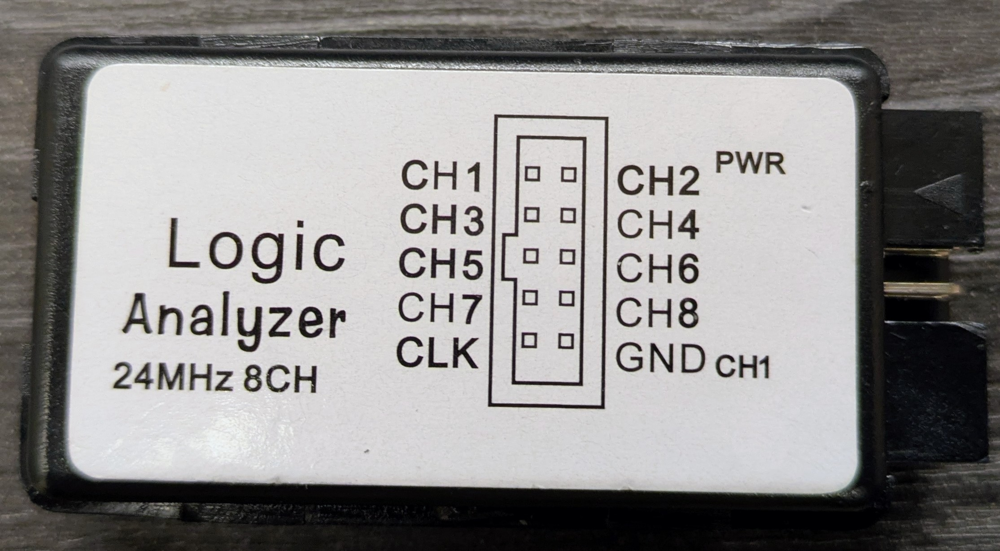

# WebPulse

English · [繁體中文](README.zh-TW.md)

WebPulse is logic analyzer software for the inexpensive 8-channel, 24 MHz USB
analyzers built around the Cypress FX2 (CY7C68013A) or the compatible
CBM9002A. A small C program captures the data and serves a browser UI. It is
a lightweight alternative to PulseView.

```
FX2 board ──USB──▶ webpulse (C: libusb + CivetWeb) ──HTTP/WebSocket──▶ browser
```


**Contents:**
- [Supported hardware](#supported-hardware)
- [Features](#features)
- [Quick start](#quick-start)
- [Using the UI](#using-the-ui)
- [Command line](#command-line)
- [Remote access](#remote-access)
- [Protocol decoders](#protocol-decoders)
- [Building from source](#building-from-source)
- [HTTP / WebSocket API](#http--websocket-api)
- [Licenses](#licenses)

## Supported hardware



WebPulse supports boards sold as "USB Logic Analyzer 24MHz 8CH" (as in the
photo), the WeAct LogicAnalyzerV1 and other CBM9002A boards, and any FX2 board
that runs sigrok's **fx2lafw** firmware. WebPulse ships the firmware and
uploads it to the board's RAM each time it opens the board. The board's
EEPROM is never written.

| USB ID | When it appears |
|---|---|
| `0925:3881` | Board with a programmed EEPROM, or any board after the firmware upload |
| `04B4:8613` | Board with a blank EEPROM (bare Cypress FX2) |

**Wiring.** The labels on the case count from 1, and WebPulse counts from 0:

| Case label | CH1 | CH2 | CH3 | CH4 | CH5 | CH6 | CH7 | CH8 | GND | CLK |
|---|---|---|---|---|---|---|---|---|---|---|
| WebPulse | CH0 | CH1 | CH2 | CH3 | CH4 | CH5 | CH6 | CH7 | ground | not used |

Always connect GND to the ground of the circuit you are measuring. The inputs
take 3.3 V logic; most of these boards also tolerate 5 V, but check yours.

## Features

- **Capture:** fixed-length capture at up to 24 MHz. Software trigger with a
  level or edge condition on each channel, and an adjustable pre-trigger
  share.
- **Fast on long captures:** the browser only requests the part on screen.
  Each reply is about 2 bytes per pixel, however long the capture, so even a
  256M-sample capture answers in under 1 ms.
- **Measurement:** cursors snap to edges, and the pulse under the pointer is
  measured live (high and low time, period, frequency, duty cycle).
- **Protocol decoders:** UART, SPI, I²C, parallel bus and edge counter. You can
  also write your own in JavaScript.
- **Files:** opens and saves sigrok / PulseView session files (`.sr`), and
  exports VCD, CSV and PNG.
- **Easy to deploy:** one executable with the UI built in. The Windows build
  needs no DLLs. A built-in simulator lets you try every feature without
  hardware.

Zooming in from the whole capture to single bytes, placing cursors and
measuring:


| Light theme | Decoder settings | Channel picker |
|---|---|---|
|  |  |  |

## Quick start

### 1. Download

Get the package for your system from the
[Releases](https://github.com/Brandon-git-hub/WebPulse/releases) page:

| File | System |
|---|---|
| `webpulse-<version>-win64.zip` | Windows 10 / 11 x64; no DLLs to install |
| `webpulse-<version>-linux-x86_64.tar.gz` | Linux x86_64, glibc 2.35 or newer; libusb statically linked |

After unpacking, keep the `firmware/` folder next to the executable.

### 2. Install the driver

**Windows**

1. **Unblock the download.** `webpulse.exe` is not code-signed, so Windows
   SmartScreen may warn that the app is unrecognized. Before unpacking,
   right-click the zip → **Properties** → tick **Unblock**. Or, when the
   warning appears, click **More info → Run anyway**.
2. **Install WinUSB.** Plug in the board and run
   [Zadig](https://zadig.akeo.ie/). Select the device with ID `0925:3881` or
   `04B4:8613` and install **WinUSB**. If the device is not in the list, choose
   **Options → List All Devices**.
3. **Install WinUSB for the second ID if needed.** After WebPulse uploads the
   firmware, the board reconnects as `0925:3881`. If Zadig shows that ID
   without WinUSB, install WinUSB for it as well. This is needed only once.

**Linux**

Let ordinary users access the board with a udev rule, for example
`/etc/udev/rules.d/60-webpulse.rules`:

```
SUBSYSTEM=="usb", ATTR{idVendor}=="0925", ATTR{idProduct}=="3881", MODE="0666"
SUBSYSTEM=="usb", ATTR{idVendor}=="04b4", ATTR{idProduct}=="8613", MODE="0666"
```

Then run `sudo udevadm control --reload && sudo udevadm trigger` and replug the
board.

> **Docker:** after the firmware upload the board comes back with a new device
> number. Mount the whole USB tree rather than a single device node:
> `-v /dev/bus/usb:/dev/bus/usb --device-cgroup-rule='c 189:* rmw'`.
> Put the udev rule on the host. The container does not need udev.

### 3. Start

Double-click `webpulse.exe`, or run `./webpulse` on Linux. The UI opens in
your browser at the address WebPulse prints, normally http://localhost:9002/.
Closing the console window, or pressing Ctrl+C, stops WebPulse.

Choose the sample rate and the number of samples in the toolbar, then click
**Run**. The first time WebPulse opens the board, uploading the firmware takes
about 1–2 s.

No hardware yet? `webpulse -b sim` starts the simulator, which generates
UART, SPI, PWM and other test signals.

## Using the UI

### Mouse and keyboard

| Action | Mouse / key |
|---|---|
| Zoom in / out ×2 around the pointer | Left / right double-click (with Ctrl: ×8), or the wheel |
| Pan | Left drag, or Shift+wheel |
| Fit the whole capture | `F` |
| Zoom to cursors A–B | `Z` |
| Previous view | `Backspace` |
| Place cursor A / B | Shift+left / Shift+right click; hold to drag |
| Move cursor A to the previous / next edge | `[` / `]` (cursor B: `{` / `}`) |
| Go to the trigger | `T` |
| Run / stop / clear cursors | `R` / `S` / `Esc` |

The toolbar has the same zoom in, zoom out, Fit, A↔B and Back buttons.

A cursor snaps to an edge within 8 px. Hold Alt while placing it to turn
snapping off. Edge navigation uses the channel highlighted under the pointer.

### Live measurement

The channel row under the pointer is highlighted. The status bar shows the
high time, low time, period, frequency and duty cycle of the pulse under the
pointer, and the pulse is marked on the waveform. The Edge ◀ ▶ buttons in the
status bar move cursor A (B with Shift) like `[` and `]`.

### Channels

The **Channels** button opens a channel picker like PulseView's. Show or hide
channels one at a time, or in groups:

| Group | Channels |
|---|---|
| All | All channels |
| Changing / Non-changing | Channels that do / do not toggle in the current capture |
| Named / Unnamed | Channels renamed from the default `CHn`, or not |

Hidden channels are ignored by the trigger and left out of exported files. The
hardware still captures all 8. Drag the grip at the left of a channel row to
reorder the channels; **Reset order** in the picker restores CH0 … CH7.

### Files

| Button | Action |
|---|---|
| **Open** (or drop a file on the page) | Opens a sigrok session file saved by PulseView or sigrok-cli. Channel names come from the file. Files with more than 8 channels load the first 8. |
| **Save .sr** | Saves a session file that PulseView can open. Includes the channel names and only the shown channels. |
| **VCD** / **CSV** / **PNG** | Exports the capture or a screenshot of the current view. |

## Command line

```bash
webpulse                     # FX2 board; UI at http://localhost:9002/, opens the browser
webpulse --no-browser        # do not open the browser
webpulse -b sim              # simulator, no hardware needed
webpulse --listen 0.0.0.0    # allow other computers to connect (see Remote access)
```

If port 9002 is in use (some editors use it), WebPulse tries the next free
port, up to 9011, and prints the address. With `-p PORT` it uses only that
port, and stops with the reason if the port is unavailable.

**Capture or convert without the UI:**

```bash
webpulse -c -r 24M -n 10M -t XXXXXXXR --pre 10 -o capture.vcd   # capture straight to a file
webpulse --open capture.sr -o capture.csv                         # convert .sr to .vcd / .csv / .sr
webpulse --open capture.sr                                        # show a file in the UI
```

**Trigger string:** 8 characters, one per channel; the *i*-th character
applies to CH*i*. All conditions must hold at the same time (AND).

| Character | `X` | `0` | `1` | `R` | `F` | `E` |
|---|---|---|---|---|---|---|
| Condition | don't care | low | high | rising edge | falling edge | either edge |

`--channels 0-3,6` limits the output file to those channels. Run
`webpulse --help` for every option.

## Remote access

By default WebPulse accepts connections only from the local computer. With
`--listen 0.0.0.0` (or the address of one of the computer's network
interfaces), other computers can connect, but they need an access token.
WebPulse generates a random token at start-up and prints the address to open:

```
WebPulse 0.2.2 listening on port 9002  (Ctrl+C to quit)
  on this computer:  http://localhost:9002/
  from elsewhere:    http://<this-computer>:9002/?token=930b25a523cc8bb39041ac3f524115ba
```

- After the address has been opened once, the browser keeps the token in a
  cookie and removes it from the address bar.
- Without the token, the page asks for it and the API answers 401.
  Connections from the local computer never need a token.
- `--token TOKEN` sets a fixed token (8–64 characters, useful for
  bookmarks). `--no-auth` turns the check off.
- The connection is plain HTTP: use it only on a trusted network, and open the
  port in the firewall.

Behind code-server, run WebPulse in the container and open
`https://<code-server>/proxy/9002/`. The UI uses only relative URLs, so it
works under that path prefix.

## Protocol decoders

The **Decoders** button adds a decoder below the channels:

| Decoder | Decodes |
|---|---|
| UART | Asynchronous serial data |
| SPI | CLK, MOSI, MISO, CS |
| I²C | SCL, SDA; addresses, data, ACK / NACK |
| Parallel | A bus value from up to 8 channels, optionally clocked |
| Counter | Numbers the edges of a channel |

- When a decoder is added, its inputs are assigned by channel name. For
  example, a channel named `SCLK` goes to SPI's CLK and one named `SDA` goes to
  I²C's SDA.
- Click a decoder's row label to change its channel assignment and options.
- Hover an annotation to see its full text in the status bar.
- Decoders run in the browser on the transitions of the channels they use, so
  even a 256M-sample capture decodes in about a second.

### Writing your own decoder

A decoder is a JavaScript module in the `decoders/` folder next to the
executable (or in the folder given with `--decoders DIR`). After adding or
editing one, click **Reload** in the Decoders panel; there is no need to
restart WebPulse. `decoders/pwm.js` is a short example, and the built-in
decoders in `web/decoders/` are complete ones.

```js
export default {
  id: 'pwm',
  name: 'PWM',
  desc: 'Duty cycle of each period',                  // optional
  channels: [{ id: 'pwm', name: 'PWM' }],              // inputs; see the table below
  options: [{ id: 'active', name: 'Active level', default: 'high', values: ['high', 'low'] }],
  rows: [{ id: 'duty', name: 'Duty' }],                // annotation rows, top to bottom

  *decode(d, o) {                                      // o = the option values
    let start = yield d.wait({ pwm: 'r' });
    for (;;) {
      const mid = yield d.wait({ pwm: 'f' });
      const end = yield d.wait({ pwm: 'r' });
      const duty = (100 * (mid - start)) / (end - start);
      d.put(start, end, 'duty', [`${duty.toFixed(1)} %`, `${Math.round(duty)}`]);
      start = end;
    }
  },
};
```

**Channel definition fields:**

| Field | Meaning |
|---|---|
| `optional: true` | The input may be left unassigned |
| `auto: true` | Assign this optional input automatically when the decoder is added |
| `aliases: ['sck']` | Other channel names that match this input |

**How decoding works.** `decode` is a generator. `yield d.wait(cond)` waits for
the next sample that matches `cond` and returns its sample index. Waiting
always moves forward: a condition that already holds at the current sample
does not match. When nothing matches before the end of the capture, decoding
stops. Code in a `finally` block still runs, for example to close an
annotation that lasts until the end.

| API | Description |
|---|---|
| `{ rx: 'f' }` | One condition per channel, all of which must hold: `'r'` rising, `'f'` falling, `'e'` either edge, `'h'` high, `'l'` low |
| `[{ clk: 'r' }, { cs: 'e' }]` | Any one of several conditions; `d.matched[i]` tells which held |
| `{ skip: n }` | n samples later (may be fractional) |
| `d.until(s)` | At sample index s |
| `d.pins.rx` | Level of the channel at the current sample (0 or 1) |
| `d.samplenum` / `d.rate` / `d.n` | Current sample index, sample rate (Hz), samples in the capture |
| `d.has('cs')` | Whether an optional input is assigned |
| `d.put(start, end, row, texts)` | Adds an annotation; `texts` is a string, or an array from longest to shortest, of which the longest that fits is shown |
| `d.hex(v, bits)`, `d.bin`, `d.dec`, `d.oct`, `d.ascii(v)`, `d.format(v, bits, 'hex')` | Formatting helpers |

An error thrown by a decoder is shown in its row, with the file and line.
Annotations made before the error are kept.

## Building from source

**Linux:** the FX2 backend is built when pkg-config finds libusb-1.0. Without
it, only the simulator is built.

```bash
cmake -S . -B build/linux -G Ninja
cmake --build build/linux
ctest --test-dir build/linux
```

A libusb built without udev is enough, and also works in a container. To
build it statically:

```bash
./configure --prefix=$HOME/libusb-linux --disable-udev --enable-static --disable-shared CFLAGS="-O2 -fPIC"
make install
export PKG_CONFIG_PATH=$HOME/libusb-linux/lib/pkgconfig
```

If `PKG_CONFIG_PATH` also lists a MinGW sysroot, put the Linux directory first.
Both contain a `libusb-1.0.pc`, and pkg-config uses the first one it finds.

**Windows:** cross-compile from Linux with llvm-mingw. The toolchain file looks
for the tools under `$TOOLS_ROOT`, by default `/mnt/ssd/tools`.

```bash
cmake -S . -B build/win -G Ninja -DCMAKE_TOOLCHAIN_FILE=cmake/mingw-w64-x86_64.cmake
cmake --build build/win        # -> build/win/webpulse.exe + build/win/firmware/
```

`.github/workflows/build.yml` shows the full setup from scratch.

### Tests

| Test | Covers |
|---|---|
| `ctest` | C unit tests: trigger, store, FX2 protocol, JSON, capture engine, VCD / CSV export, ZIP / `.sr` read and write; also the decoder tests when Node.js is found |
| `tests/decoders_test.mjs` | The decoder runtime and the built-in decoders, on generated waveforms |
| `tests/web_smoke.mjs` | Runs `web/js/app.js` under Node 22+ with a fake DOM against a running server |
| `tests/browser_check.mjs` | Drives the UI in headless Chrome (`$CHROME` or `chromium`): layout alignment, decoders running in a Web Worker, no script errors |
| `tools/docshots.mjs` | Regenerates the README screenshots in `docs/images` |

`web_smoke.mjs`, `browser_check.mjs` and `docshots.mjs` need a running server.
Start the simulator first:

```bash
./build/linux/webpulse -b sim -p 18080 -d decoders &
node tests/web_smoke.mjs http://127.0.0.1:18080/
```

### Source layout

```
src/          C11 daemon: capture engine, trigger, store, device backends, HTTP server
web/          UI (plain ES modules, no build step), embedded into the executable
  decoders/   built-in protocol decoders
  js/decode/  decoder runtime
decoders/     example user decoder, copied next to the executable
tests/        unit tests, decoder tests, smoke test, browser check
tools/        embed_web.py, package.py (release archives), docshots.mjs (README images)
cmake/        Windows cross-compile toolchain
firmware/     fx2lafw-saleae-logic.fw (GPLv2+, loaded at run time)
third_party/  CivetWeb 1.16 (MIT)
```

## HTTP / WebSocket API

| Method | Path | Description |
|---|---|---|
| GET | `/api/device` | Backend, model, firmware, supported rates, maximum samples |
| POST | `/api/capture` | Start a capture: `{"rate":24000000,"samples":10000000,"pre":0.1,"trigger":"XXXXXXXR","timeout_ms":0}` |
| POST | `/api/stop` | Stop; samples captured after the trigger are kept |
| GET | `/api/status` | State (`idle` / `armed` / `capturing` / `processing` / `done` / `error`) and progress; `capture.changing` is the mask of channels that toggle |
| GET | `/api/export?fmt=vcd\|csv\|sr[&names=a,b,…][&channels=0-3,6][&changes=0]` | Download the capture; `channels` selects the channels (default: all) |
| POST | `/api/open?name=FILE.sr` | The body is a sigrok session file, which becomes the current capture |
| GET | `/api/transitions?mask=M[&from=S]` | Binary list of the sample indices where the channels in mask `M` change; used by the decoders (format: `api_transitions` in `src/server.c`) |
| GET | `/api/decoders`, `/api/decoders/NAME.js` | User decoder files from `--decoders DIR` |

**WebSocket `/ws`.** The server pushes `{"type":"status",…}` whenever the
state changes. A waveform query
`{"type":"query","id":1,"t0":0,"t1":1000000,"width":1200}` gets a binary
reply (little-endian):

```
u32 id | u8 mode | u8 0 | u16 width | u64 t0 | u64 t1 | payload
mode 0: raw samples t0..t1 (1 byte per sample, bit c = CH c)
mode 1: u16 per pixel, bit 2c = CH c was high, bit 2c+1 = CH c was low
```

An edge query `{"type":"edges","id":7,"ch":5,"s":1000}` returns the edges of
CH5 around sample 1000:
`{"type":"edges","id":7,"ch":5,"s":1000,"level":0,"pm":912,"p":960,"n":1008,"nn":1056}`.
`p` is where the current level started and `n` is the next edge; `pm` and `nn`
are the edges before `p` and after `n` (-1 if there is none). The search skips
constant stretches through the summary pyramid, so it is fast on any capture
length.

## Licenses

WebPulse is released under the MIT License (see `LICENSE`).

- **libusb** (LGPL-2.1) is statically linked into the release executables. Its
  source is at https://github.com/libusb/libusb; the releases use 1.0.30. To
  use a modified libusb, rebuild WebPulse against it as described in
  [Building from source](#building-from-source).
- **CivetWeb** (MIT): `third_party/civetweb/LICENSE.md`.
- **fx2lafw firmware** (GPLv2+): shipped as a separate file in `firmware/` with
  its own `COPYING`. It is loaded at run time and is not compiled into the
  executable, so it keeps its own license.
