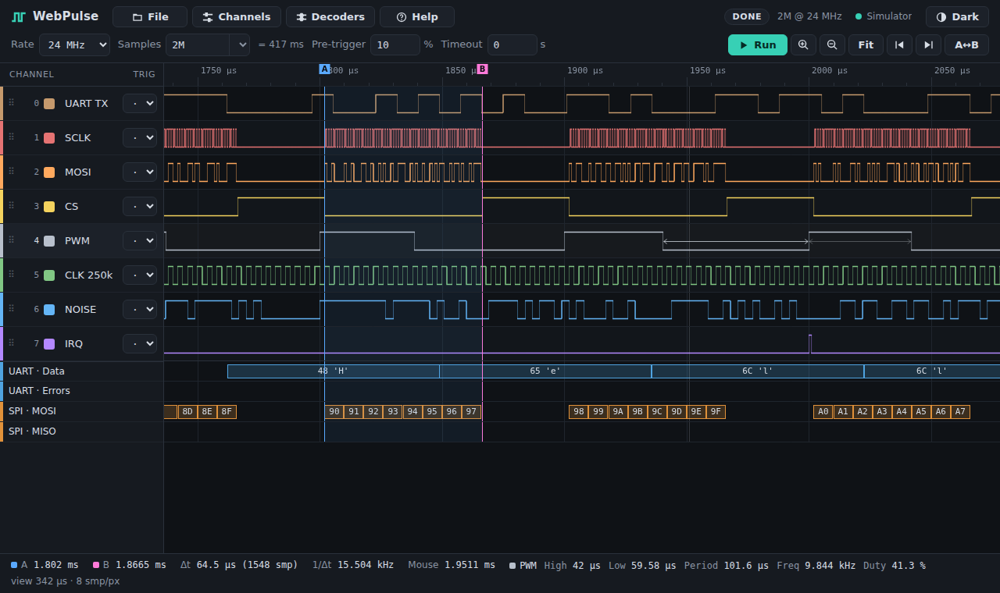
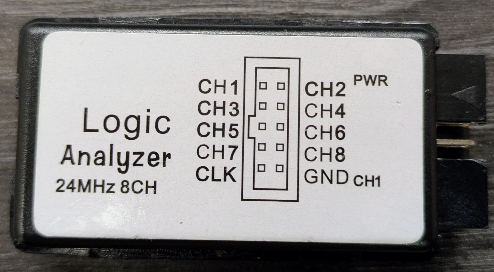
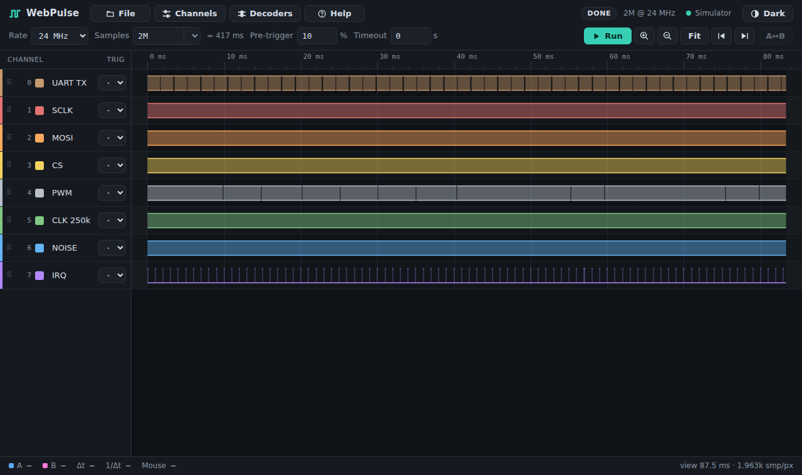
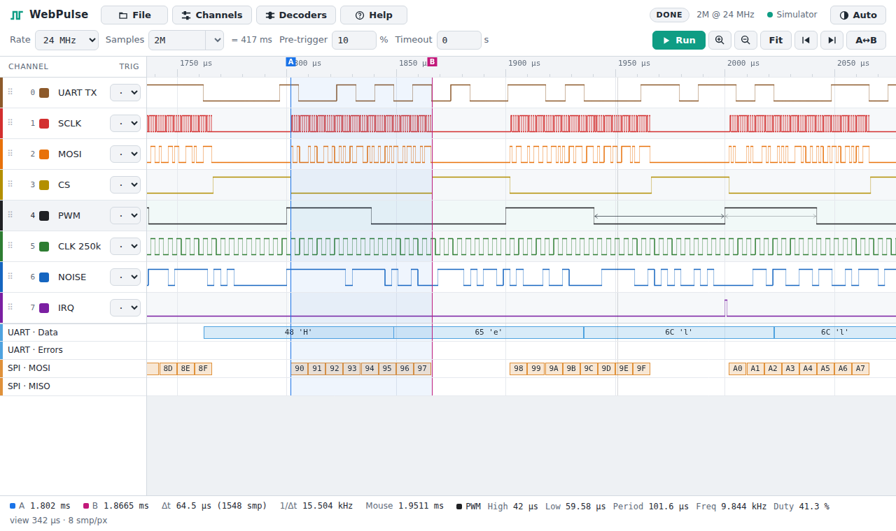
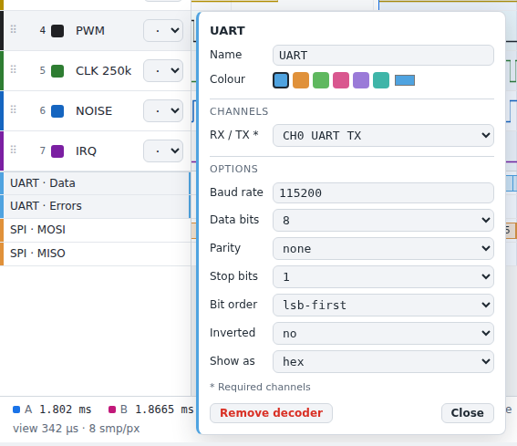
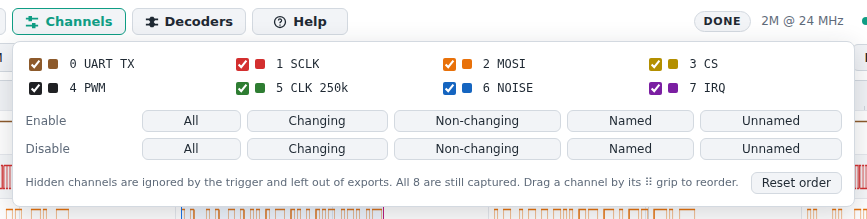

# WebPulse

[English](README.md) · 繁體中文

WebPulse 是一套適用於 Cypress FX2（CY7C68013A）或相容晶片 CBM9002A 的 8 通道邏輯分析儀軟體，支援市面上常見的平價 24 MHz USB 邏輯分析儀。由輕量的 C 程式負責擷取資料，並以瀏覽器作為操作介面，定位為 PulseView 的輕量化替代方案。

```
FX2 裝置 ──USB──▶ webpulse (C: libusb + CivetWeb) ──HTTP/WebSocket──▶ 瀏覽器
```



**目錄：**
- [支援硬體](#支援硬體)
- [功能特色](#功能特色)
- [快速開始](#快速開始)
- [操作說明](#操作說明)
- [命令列](#命令列)
- [遠端存取](#遠端存取)
- [協定解碼器](#協定解碼器)
- [從原始碼編譯](#從原始碼編譯)
- [HTTP 與 WebSocket API](#http-與-websocket-api)
- [授權](#授權)

## 支援硬體



支援以下硬體：

- 外殼標示為「Logic Analyzer 24MHz 8CH」的 USB 邏輯分析儀（如上圖）
- WeAct LogicAnalyzerV1 及其他 CBM9002A 板
- 其他可執行 sigrok **fx2lafw** 韌體的 FX2 板

WebPulse 隨附 fx2lafw 韌體，每次開啟裝置時會將韌體載入裝置的 RAM，不會寫入 EEPROM。

| USB ID | 出現時機 |
|---|---|
| `0925:3881` | EEPROM 已燒錄的裝置，或任何裝置載入韌體之後 |
| `04B4:8613` | EEPROM 空白的裝置（原廠 Cypress FX2） |

**接線：** 外殼標示從 1 開始編號，WebPulse 介面則從 0 開始：

| 外殼標示 | CH1 | CH2 | CH3 | CH4 | CH5 | CH6 | CH7 | CH8 | GND | CLK |
|---|---|---|---|---|---|---|---|---|---|---|
| WebPulse | CH0 | CH1 | CH2 | CH3 | CH4 | CH5 | CH6 | CH7 | 接地 | 不使用 |

量測時務必將 GND 連接至待測電路的地。輸入為 3.3 V 邏輯準位；多數此類裝置也可耐受 5 V，但仍請先確認您的裝置規格。

## 功能特色

- **擷取：** 固定長度擷取，最高 24 MHz。支援軟體觸發，每個通道可設定準位或邊緣條件，觸發前資料比例可調整。
- **長時間擷取依然流暢：** 瀏覽器僅向伺服器請求目前檢視範圍的資料，每次回應約為每像素 2 bytes，與擷取長度無關；即使是 2.56 億個取樣點，也能在 1 ms 內回應。
- **量測：** 游標會自動吸附訊號邊緣；滑鼠所在的脈衝會即時量測高準位時間、低準位時間、週期、頻率與工作週期（Duty Cycle）。
- **協定解碼：** 內建 UART、SPI、I²C、並列匯流排與邊緣計數器，也能以 JavaScript 撰寫自訂解碼器。
- **檔案：** 可開啟與儲存 sigrok / PulseView 工作階段檔（`.sr`），並可匯出 VCD、CSV、PNG，以及文字格式的解碼標註。
- **部署簡單：** 單一執行檔即包含完整介面，Windows 版不需要額外安裝 DLL。內建模擬裝置，沒有硬體也能體驗所有功能。

從整段擷取逐步放大至單一位元組，接著放置游標並進行量測：



| 淺色主題 | 解碼器設定 | 通道選擇 |
|---|---|---|
|  |  |  |

## 快速開始

### 1. 下載

請至 [Releases](https://github.com/Brandon-git-hub/WebPulse/releases) 頁面下載對應系統的套件：

| 檔案 | 適用系統 |
|---|---|
| `webpulse-<版本>-win64.zip` | Windows 10 / 11 x64，不需要安裝 DLL |
| `webpulse-<版本>-linux-x86_64.tar.gz` | Linux x86_64，需要 glibc 2.35 以上；已靜態連結 libusb |
| `webpulse-<版本>-macos-universal.tar.gz` | macOS 11 以上，支援 Apple silicon 與 Intel；已靜態連結 libusb |

解壓縮後，請將 `firmware/` 資料夾與執行檔放在同一個目錄。

### 2. 安裝驅動程式

**Windows**

1. **解除封鎖：** 由於 `webpulse.exe` 沒有程式碼簽章，Windows SmartScreen 可能會顯示「無法辨識的應用程式」警告。請在解壓縮**之前**，於 zip 檔按右鍵 →「**內容**」→ 勾選「**解除封鎖**」；或在出現警告時點選「**其他資訊 → 仍要執行**」。
2. **安裝 WinUSB：** 接上裝置後執行 [Zadig](https://zadig.akeo.ie/)，選擇 ID 為 `0925:3881` 或 `04B4:8613` 的裝置，安裝 **WinUSB** 驅動程式。若下拉選單中找不到裝置，請點選頂部選單的「**Options → List All Devices**」。
3. **必要時為第二個 ID 安裝 WinUSB：** WebPulse 載入韌體後，裝置會以 `0925:3881` 重新連線。若 Zadig 顯示此 ID 尚未安裝 WinUSB，請再安裝一次。此步驟只需執行一次。

**Linux**

建立 udev 規則讓一般使用者可以存取裝置，例如 `/etc/udev/rules.d/60-webpulse.rules`：

```
SUBSYSTEM=="usb", ATTR{idVendor}=="0925", ATTR{idProduct}=="3881", MODE="0666"
SUBSYSTEM=="usb", ATTR{idVendor}=="04b4", ATTR{idProduct}=="8613", MODE="0666"
```

接著執行 `sudo udevadm control --reload && sudo udevadm trigger`，並重新插拔裝置。

> **Docker：** 載入韌體後，裝置會以新的裝置編號重新出現，因此請掛載整個 USB 目錄，而非單一裝置節點：
> `-v /dev/bus/usb:/dev/bus/usb --device-cgroup-rule='c 189:* rmw'`。
> udev 規則請設定在主機端，容器內不需要 udev。

**macOS**

不需要安裝驅動程式。`webpulse` 沒有程式碼簽章，從瀏覽器下載的檔案會被 macOS 封鎖。請在解壓縮後的資料夾中執行一次以下指令，移除隔離標記：

```bash
xattr -dr com.apple.quarantine .
```

### 3. 啟動

在 Windows 上雙擊 `webpulse.exe`，會直接在預設瀏覽器開啟介面，不會出現主控台視窗；關閉最後一個顯示 WebPulse 的瀏覽器分頁後，數秒內程式即自動結束。程式執行中再次雙擊，只會重新開啟介面。紀錄檔位於 `%TEMP%\webpulse.log`，導致程式結束的錯誤會以對話框顯示。

從終端機執行（cmd、PowerShell，或在 Linux 與 macOS 上執行 `./webpulse`）時，程式會顯示網址（通常為 http://localhost:9002/）與執行紀錄，並同樣開啟瀏覽器；按 Ctrl+C 或關閉終端機即可結束。如需使用下方的選項（例如讓其他電腦連線），請從終端機執行。

在工具列選擇取樣率與取樣點數，再點選 **Run** 開始擷取。第一次開啟裝置時，載入韌體約需 1 至 2 秒。

還沒有硬體嗎？執行 `webpulse -b sim` 即可啟動模擬裝置，產生 UART、SPI、PWM 等測試訊號。

## 操作說明

### 滑鼠與鍵盤

| 功能 | 滑鼠 / 按鍵 |
|---|---|
| 以滑鼠位置為中心放大 / 縮小 2 倍 | 左鍵 / 右鍵雙擊（按住 Ctrl 為 8 倍），或滾輪 |
| 平移 | 左鍵拖曳，或 Shift + 滾輪 |
| 顯示完整擷取 | `F` |
| 放大至游標 A–B 區間 | `Z` |
| 放置游標 A / B | Shift + 左鍵 / Shift + 右鍵；按住不放可拖曳 |
| 游標 A 移至上一個 / 下一個邊緣 | `[` / `]`（游標 B 為 `{` / `}`） |
| 跳至觸發點 | `T` |
| 開始 / 停止 / 清除游標 | `R` / `S` / `Esc` |
| 列出所有快捷鍵 | `?`，或 **Help** ▸ **Keyboard shortcuts** |

工具列第二列右側、**Run** 之後也提供放大、縮小、Fit、上一個 / 下一個邊緣與 A↔B 按鈕。第一列會固定顯示裝置是否已連接，最右側為主題切換（Auto / Light / Dark）。**Help** ▸ **About WebPulse** 可查看版本、建置日期、作業系統、相依套件與授權。**Help** ▸ **Language** 可切換英文與繁體中文介面，預設為英文；解碼器本身的名稱與選項維持英文。

游標會自動吸附 8 px 範圍內的邊緣；放置時按住 Alt 可停用吸附。邊緣導覽以滑鼠所在、目前反白的通道為準。

### 即時量測

滑鼠所在的通道列會反白，狀態列即時顯示該處脈衝的高準位時間、低準位時間、週期、頻率與工作週期，波形上也會標示出該脈衝。狀態列的 Edge ◀ ▶ 按鈕與 `[`、`]` 相同，可移動游標 A（按住 Shift 則移動游標 B）。

### 通道

**Channels** 按鈕會開啟與 PulseView 類似的通道選擇面板，可逐一顯示或隱藏通道，也能依下列分類批次操作：

| 分類 | 包含的通道 |
|---|---|
| All | 所有通道 |
| Changing / Non-changing | 目前擷取中有 / 沒有訊號變化的通道 |
| Named / Unnamed | 已修改 / 未修改預設名稱 `CHn` 的通道 |

隱藏的通道不參與觸發，也不會匯出至檔案；硬體仍會擷取全部 8 個通道。拖曳通道列左側的握把可調整通道順序，在面板中按 **Reset order** 即可恢復為 CH0 … CH7。

### 檔案

工具列左側的 **File** 選單：

| 項目 | 功能 |
|---|---|
| **Open…**（Ctrl+O，或將檔案拖放至網頁） | 開啟 PulseView 或 sigrok-cli 儲存的工作階段檔，通道名稱沿用檔案設定；超過 8 個通道的檔案只載入前 8 個 |
| **Save session**（Ctrl+S） | 儲存為 PulseView 可開啟的工作階段檔（`.sr`），包含通道名稱，且只包含目前顯示的通道 |
| **Export ▸ VCD / CSV** | 將擷取資料匯出為 VCD 或 CSV 檔，只包含目前顯示的通道 |
| **Export ▸ PNG image** | 將目前畫面存成圖片，包含通道名稱與解碼標註 |
| **Export ▸ Decoder annotations…** | 將單一解碼器的標註存成文字檔，可選擇要匯出的列與範圍（整份擷取資料、目前畫面，或游標 A 與 B 之間）。格式請參閱[文字格式的解碼標註](#文字格式的解碼標註) |

## 命令列

```bash
webpulse                     # 使用 FX2 裝置，介面位於 http://localhost:9002/，並自動開啟瀏覽器
webpulse --no-browser        # 不自動開啟瀏覽器
webpulse -b sim              # 模擬裝置，不需要硬體
webpulse --listen 0.0.0.0    # 允許其他電腦連線（請參閱「遠端存取」）
```

若 9002 埠已被佔用（部分編輯器會使用此埠），WebPulse 會依序嘗試下一個可用的埠，最多到 9011，並顯示實際網址。若以 `-p PORT` 指定埠號，則只使用該埠；無法使用時會停止並顯示原因。

**不開啟介面，直接擷取或轉檔：**

```bash
webpulse -c -r 24M -n 10M -t XXXXXXXR --pre 10 -o capture.vcd   # 擷取並直接存檔
webpulse --open capture.sr -o capture.csv                         # 將 .sr 轉為 .vcd / .csv / .sr
webpulse --open capture.sr                                        # 在介面中開啟檔案
```

**觸發條件字串：** 共 8 個字元，第 *i* 個字元對應 CH*i*，所有條件必須同時成立（AND）。

| 字元 | `X` | `0` | `1` | `R` | `F` | `E` |
|---|---|---|---|---|---|---|
| 條件 | 不限 | 低準位 | 高準位 | 上升邊緣 | 下降邊緣 | 任一邊緣 |

`--channels 0-3,6` 可限制輸出檔只包含指定的通道。執行 `webpulse --help` 可查看所有選項。

## 遠端存取

WebPulse 預設只接受本機連線。使用 `--listen 0.0.0.0`（或本機某個網路介面的位址）後，其他電腦即可連線，但需要存取權杖（Access Token）。WebPulse 啟動時會產生一組隨機權杖，並顯示連線網址：

```
WebPulse 0.3.1 listening on port 9002  (Ctrl+C to quit)
  on this computer:  http://localhost:9002/
  from elsewhere:    http://<this-computer>:9002/?token=930b25a523cc8bb39041ac3f524115ba
```

- 以此網址開啟一次後，瀏覽器會以 Cookie 保存權杖，並自動從網址列移除。
- 未提供權杖時，網頁會要求輸入權杖，API 則回應 401。從本機連線不需要權杖。
- `--token TOKEN` 可指定固定權杖（8 至 64 個字元，方便加入書籤）；`--no-auth` 則停用驗證。
- 連線採用未加密的 HTTP，請僅在信任的網路中使用，並於防火牆開放對應的埠。

若在 code-server 環境中使用，請在容器內執行 WebPulse，並開啟 `https://<code-server>/proxy/9002/`。由於介面只使用相對路徑，在此路徑前綴下也能正常運作。

## 協定解碼器

點選工具列的 **Decoders**，右側會開啟解碼器清單。可輸入關鍵字搜尋（名稱、說明或通道），在解碼器上按兩下或按 Enter，即可將其加入通道下方。加入後清單會保持開啟，方便連續加入多個解碼器。

| 解碼器 | 說明 |
|---|---|
| UART | 非同步序列資料 |
| SPI | CLK、MOSI、MISO、CS |
| I²C | SCL、SDA；位址、資料與 ACK / NACK |
| Parallel | 由最多 8 個通道組成的匯流排數值，可選擇是否使用時脈 |
| Counter | 為通道的每個邊緣編號 |

- 新增解碼器時，會依通道名稱自動指派輸入。例如命名為 `SCLK` 的通道會指派給 SPI 的 CLK，命名為 `SDA` 的通道會指派給 I²C 的 SDA。
- 點選解碼器的列名稱可開啟設定：名稱、顏色、通道與選項。每項修改都會立即套用並重新解碼；最下方為 **Remove decoder**（移除解碼器）。
- 將滑鼠移至協定解碼標註上，狀態列會顯示完整內容。
- 解碼器可以輸出摘要（例如時序檢查的總表）。摘要顯示在解碼器設定的最下方，匯出標註時也會寫在檔案最後。
- 解碼器在瀏覽器中執行，且只處理所使用通道的訊號轉換點，因此即使是 2.56 億個取樣點的擷取，也約在一秒內完成解碼。

### 撰寫自訂解碼器

自訂解碼器是一個 JavaScript 模組，放在執行檔旁的 `decoders/` 資料夾（或以 `--decoders DIR` 指定的資料夾）。新增或修改後，點選解碼器清單下方的 **Reload** 即可載入，不需重新啟動 WebPulse。`decoders/pwm.js` 是簡短的範例，`web/decoders/` 中的內建解碼器則是完整的參考實作。

```js
export default {
  id: 'pwm',
  name: 'PWM',
  desc: 'Duty cycle of each period',                  // 選用
  channels: [{ id: 'pwm', name: 'PWM' }],              // 輸入通道，欄位說明見下表
  options: [{ id: 'active', name: 'Active level', default: 'high', values: ['high', 'low'] }],
  rows: [{ id: 'duty', name: 'Duty' }],                // 標註列，由上而下排列

  *decode(d, o) {                                      // o 為各選項的設定值
    let start = yield d.wait({ pwm: 'r' });
    for (;;) {
      const mid = yield d.wait({ pwm: 'f' });
      const end = yield d.wait({ pwm: 'r' });
      const duty = (100 * (mid - start)) / (end - start);
      d.put(start, end, 'duty', [`${duty.toFixed(1)} %`, `${Math.round(duty)}`]);
      start = end;
    }
  },
};
```

**通道定義欄位：**

| 欄位 | 說明 |
|---|---|
| `optional: true` | 此輸入為選用，可不指派 |
| `auto: true` | 新增解碼器時，也自動指派此選用輸入 |
| `aliases: ['sck']` | 可對應此輸入的其他通道名稱 |

標註列可加上 `export: false`（例如 `{ id: 'bits', name: 'Bits', export: false }`），匯出標註時這一列預設不勾選，適合筆數非常多的列。

**解碼流程：** `decode` 是一個 generator 函式。`yield d.wait(cond)` 會等待下一個符合 `cond` 的取樣點，並回傳其取樣點索引。等待一律向後推進：在目前取樣點已成立的條件不會被視為符合。若直到擷取結束都沒有符合的取樣點，解碼即停止；`finally` 區塊中的程式碼仍會執行，可用於結束持續到最後的標註或輸出摘要，其中拋出的錯誤也會和其他錯誤一樣顯示。

標註可以依任意順序加入，每一列最後都會依開始時間排序。預設值為數字的選項會以數字傳入（直接用 `o.gap`，不需 `Number(o.gap)`）；已儲存的設定中缺少的選項會使用預設值。

| API | 說明 |
|---|---|
| `{ rx: 'f' }` | 每個通道一個條件，須全部成立：`'r'` 上升、`'f'` 下降、`'e'` 任一邊緣、`'h'` 高準位、`'l'` 低準位 |
| `[{ clk: 'r' }, { cs: 'e' }]` | 多組條件中任一組成立即可；`d.matched[i]` 表示哪一組成立 |
| `{ skip: n }` | 往後 n 個取樣點（可為小數） |
| `d.until(s)` | 取樣點索引 s |
| `d.pins.rx` | 目前取樣點該通道的準位（0 或 1） |
| `d.prev.rx` | 目前取樣點前一刻的準位，例如時脈邊緣前一刻的資料線 |
| `d.samplenum` / `d.rate` / `d.n` | 目前取樣點索引、取樣率（Hz）、擷取的總取樣點數 |
| `d.has('cs')` | 選用輸入是否已指派 |
| `d.put(start, end, row, texts)` | 新增一筆標註；`texts` 可為字串，或由長到短排列的陣列，會依顯示空間自動選用最長的文字 |
| `d.us(samples)`、`d.ms(samples)` | 將取樣點數換算為微秒／毫秒 |
| `d.summary(text)` | 在解碼器摘要中加入文字（顯示於設定視窗，並寫入匯出檔） |
| `d.hex(v, bits)`、`d.bin`、`d.dec`、`d.oct`、`d.ascii(v)`、`d.format(v, bits, 'hex')` | 數值格式化函式 |

解碼器拋出的錯誤會連同檔名與行號顯示在該解碼器的列上，錯誤發生前產生的標註會保留。

### 文字格式的解碼標註

**File ▸ Export ▸ Decoder annotations…** 與 `tools/wp-decode.mjs` 輸出相同的格式：開頭是以 `#` 起始的檔頭，記錄結果的來源；接著每筆標註一行，欄位以 Tab 分隔（所選的列合併後依開始時間排序）；最後是摘要。

```
# WebPulse 0.3.1 decoder export
# capture   uart.sr  (modified 2026-11-27 11:46:13)
# rate      1000000 Hz, 200000 samples, no trigger
# decoder   uart  (built-in)
# channels  rx=CH0
# options   baud=115200 bits=8 parity=none stop=1 order=lsb-first invert=no format=ascii
# rows      data error
# range     all
# result    2026 annotations, 12 ms, no error
#
# start_ms	len_ms	sample	row	text
1.763	0.087	1763	data	'H' 48
1.849	0.087	1849	data	'e' 65
## summary
…
```

- 時間以毫秒為單位，從取樣點 0 起算，與 VCD、CSV 匯出一致；觸發位置記錄在檔頭，`sample` 為精確的起始取樣點索引。
- `text` 為該標註最長的文字，保持在同一行。
- 若使用自訂解碼器檔案，檔頭會記錄檔名與 CRC-32，可追溯產生結果的解碼器版本。

**不開介面直接解碼：** `tools/wp-decode.mjs` 以 Node.js 18 以上版本，對 `.sr` 檔執行解碼器。需在本專案的原始碼目錄中執行（使用 `web/js/decode/` 的執行環境）：

```bash
node tools/wp-decode.mjs capture.sr -d uart --opt baud=9600 -o capture-uart.txt
node tools/wp-decode.mjs capture.sr -d decoders/pwm.js --ch pwm=CH4 --range 10ms:20ms
node tools/wp-decode.mjs -d spi --list        # 列出解碼器的輸入、選項與標註列
```

輸入與介面相同，依通道名稱自動指派；可用 `--ch INPUT=NAME|CHn` 指定。`--rows a,b` 選擇要輸出的列。解碼器回報錯誤時結束代碼為 2（檔案仍會寫出）。`--help` 可列出所有選項。

## 從原始碼編譯

**Linux：** 若 pkg-config 找得到 libusb-1.0，會一併編譯 FX2 後端；否則只會編譯模擬裝置。

```bash
cmake -S . -B build/linux -G Ninja
cmake --build build/linux
ctest --test-dir build/linux
```

不含 udev 支援的 libusb 即可使用，也適用於容器環境。靜態編譯 libusb 的方式：

```bash
./configure --prefix=$HOME/libusb-linux --disable-udev --enable-static --disable-shared CFLAGS="-O2 -fPIC"
make install
export PKG_CONFIG_PATH=$HOME/libusb-linux/lib/pkgconfig
```

若 `PKG_CONFIG_PATH` 同時包含 MinGW sysroot，請將 Linux 的目錄放在前面。兩者都有 `libusb-1.0.pc`，pkg-config 會使用第一個找到的檔案。

**macOS：** 與 Linux 相同，需要 Xcode 命令列工具，並以 Homebrew 安裝 libusb（`brew install cmake ninja pkgconf libusb`）。若要產生不需 Homebrew 即可執行的程式，請依照 Linux 的方式靜態編譯 libusb（不加 `--disable-udev`），並將 `PKG_CONFIG_PATH` 指向該目錄；加上 `-DCMAKE_OSX_ARCHITECTURES="arm64;x86_64"` 可產生 universal binary（此時 libusb 需要 `CFLAGS="-O2 -arch arm64 -arch x86_64"` 與 `--disable-dependency-tracking`）。

**Windows：** 在 Linux 上使用 llvm-mingw 交叉編譯。工具鏈檔案會在 `$TOOLS_ROOT`（預設為 `/mnt/ssd/tools`）下尋找編譯工具。

```bash
cmake -S . -B build/win -G Ninja -DCMAKE_TOOLCHAIN_FILE=cmake/mingw-w64-x86_64.cmake
cmake --build build/win        # 產生 build/win/webpulse.exe 與 build/win/firmware/
```

從零開始的完整環境設定，請參考 `.github/workflows/build.yml`。

### 測試

| 測試 | 涵蓋範圍 |
|---|---|
| `ctest` | C 單元測試：觸發、資料儲存、FX2 協定、JSON、擷取引擎、VCD / CSV 匯出、ZIP / `.sr` 讀寫；找得到 Node.js 時也會執行解碼器測試 |
| `tests/decoders_test.mjs` | 以程式產生的波形驗證解碼器執行環境、標註匯出與內建解碼器 |
| `tests/web_smoke.mjs` | 在 Node 22+ 中以模擬 DOM 執行 `web/js/app.js`，並連線至執行中的伺服器 |
| `tests/browser_check.mjs` | 以 headless Chrome（`$CHROME` 或 `chromium`）操作介面：檢查版面對齊、解碼器在 Web Worker 中執行、無 JavaScript 錯誤 |
| `tools/docshots.mjs` | 重新產生 `docs/images` 中的 README 截圖 |

`web_smoke.mjs`、`browser_check.mjs` 與 `docshots.mjs` 需要先啟動伺服器，請先執行模擬裝置：

```bash
./build/linux/webpulse -b sim -p 18080 -d decoders &
node tests/web_smoke.mjs http://127.0.0.1:18080/
```

### 目錄結構

```
src/          C11 程式：擷取引擎、觸發、資料儲存、裝置後端、HTTP 伺服器
web/          網頁介面（純 ES modules，不需建置），編譯時嵌入執行檔
  decoders/   內建協定解碼器
  js/decode/  解碼器執行環境
decoders/     自訂解碼器範例，編譯時複製到執行檔旁
tests/        單元測試、解碼器測試、smoke test、瀏覽器測試
tools/        wp-decode.mjs（不開介面解碼 .sr 檔）、embed_web.py、make_icon.py（由 favicon 產生 Windows 圖示）、package.py（打包 Release）、docshots.mjs（README 截圖）
cmake/        Windows 交叉編譯工具鏈
firmware/     fx2lafw-saleae-logic.fw（GPLv2+，執行時載入）
third_party/  CivetWeb 1.16（MIT）
```

## HTTP 與 WebSocket API

| 方法 | 路徑 | 說明 |
|---|---|---|
| GET | `/api/device` | 後端類型、型號、韌體、`connected`（是否已連接）、支援的取樣率、最大取樣點數；版本、建置日期、作業系統、CivetWeb 與 libusb 版本（供 Help ▸ About 使用） |
| POST | `/api/capture` | 開始擷取：`{"rate":24000000,"samples":10000000,"pre":0.1,"trigger":"XXXXXXXR","timeout_ms":0}` |
| POST | `/api/stop` | 停止擷取；觸發後已擷取的資料會保留 |
| GET | `/api/status` | 狀態（`idle` / `armed` / `capturing` / `processing` / `done` / `error`）與進度；`capture.changing` 為有訊號變化的通道遮罩，`capture.time` 為擷取或開啟的時間（Unix time），`capture.source` 為開啟的檔名 |
| GET | `/api/export?fmt=vcd\|csv\|sr[&names=a,b,…][&channels=0-3,6][&changes=0]` | 下載擷取資料；`channels` 指定要包含的通道（預設為全部） |
| POST | `/api/open?name=FILE.sr` | 請求內容為 sigrok 工作階段檔，載入後成為目前的擷取 |
| GET | `/api/transitions?mask=M[&from=S]` | 遮罩 `M` 中的通道發生變化的取樣點索引，二進位格式；供解碼器使用（格式見 `src/server.c` 的 `api_transitions`） |
| GET | `/api/decoders`、`/api/decoders/NAME.js` | `--decoders DIR` 中的自訂解碼器檔案 |

**WebSocket `/ws`：** 狀態改變時，伺服器會推送 `{"type":"status",…}`。波形查詢 `{"type":"query","id":1,"t0":0,"t1":1000000,"width":1200}` 會收到二進位回應（little-endian）：

```
u32 id | u8 mode | u8 0 | u16 width | u64 t0 | u64 t1 | payload
mode 0: raw samples t0..t1 (1 byte per sample, bit c = CH c)
mode 1: u16 per pixel, bit 2c = CH c was high, bit 2c+1 = CH c was low
```

邊緣查詢 `{"type":"edges","id":7,"ch":5,"s":1000}` 會回傳 CH5 在取樣點 1000 附近的邊緣：`{"type":"edges","id":7,"ch":5,"s":1000,"level":0,"pm":912,"p":960,"n":1008,"nn":1056}`。`p` 為目前準位的起點，`n` 為下一個邊緣；`pm` 與 `nn` 分別為 `p` 之前與 `n` 之後的邊緣（不存在時為 -1）。搜尋時會利用摘要金字塔跳過沒有變化的區段，因此不論擷取長度為何都能快速完成。

## 授權

WebPulse 採用 MIT 授權條款（見 `LICENSE`）。

- **libusb**（LGPL-2.1）：以靜態連結方式編入 Release 執行檔。原始碼位於 https://github.com/libusb/libusb，Release 使用 1.0.30 版。如需使用修改過的 libusb，請依「[從原始碼編譯](#從原始碼編譯)」的步驟重新編譯 WebPulse。
- **CivetWeb**（MIT）：見 `third_party/civetweb/LICENSE.md`。
- **fx2lafw 韌體**（GPLv2+）：以獨立檔案形式隨附於 `firmware/`，並附有其 `COPYING`。韌體於執行時載入，未編入執行檔，因此維持其原有授權。
