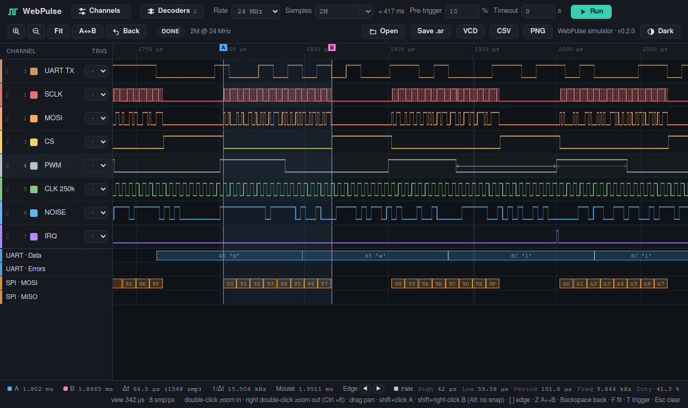
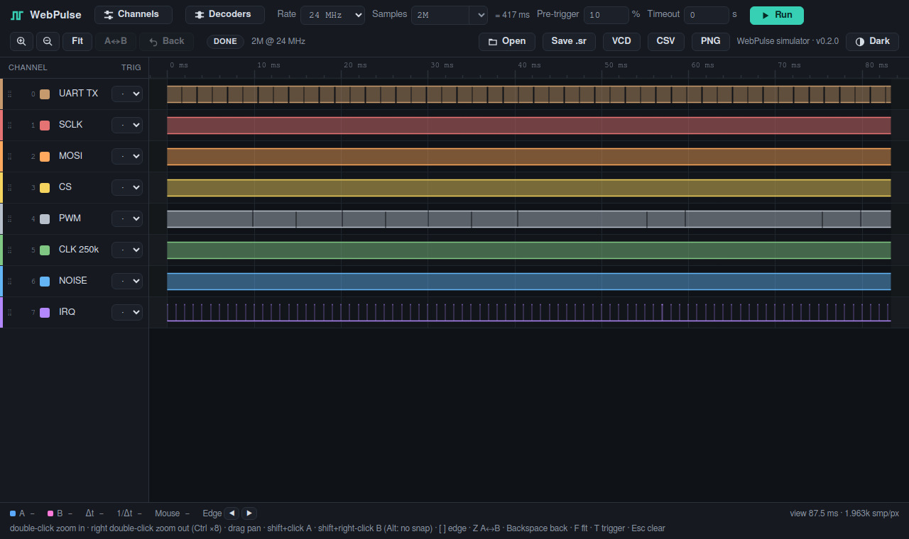
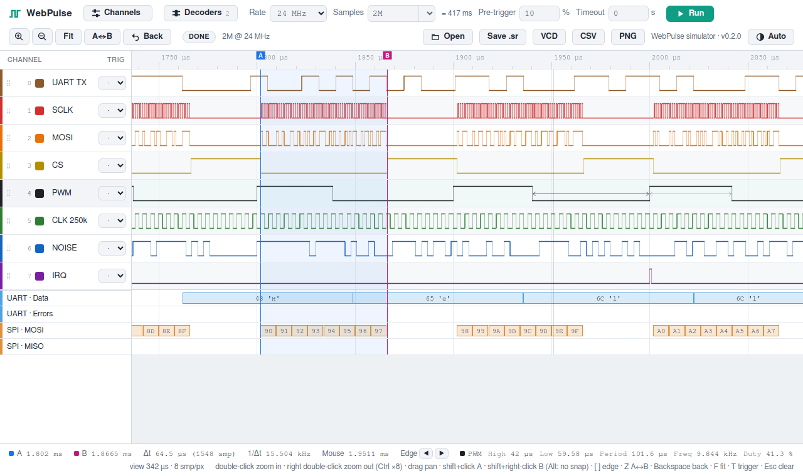
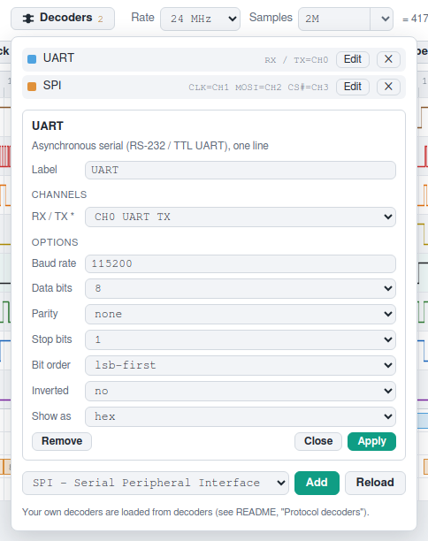
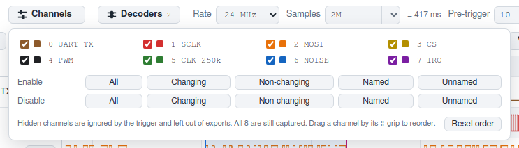

# WebPulse

[English](README.md) · 繁體中文



WebPulse 是給 Cypress FX2 板子用的 8 通道邏輯分析儀軟體，例如燒了 sigrok fx2lafw 韌體的
WeAct LogicAnalyzerV1／CBM9002A。它想當 PulseView 比較輕量的替代品：一個小小的 C 程式負責
擷取，並提供在瀏覽器用 canvas 畫波形的介面。

```
FX2 板子 ──USB──▶ webpulse（C：libusb + CivetWeb）──HTTP／WebSocket──▶ 瀏覽器
```

- 定長擷取，最高 24 MHz；軟體觸發（每個通道可設位準或邊緣條件），pre-trigger 比例可調。
- 協定解碼器（UART、SPI、I²C、並列匯流排、計數器），也能用 JavaScript 寫自己的解碼器。
- 開啟／儲存 sigrok／PulseView 的 session 檔（`.sr`）；匯出 VCD、CSV、PNG。
- 瀏覽器只向伺服器要目前畫面上的那一段。不論擷取多長，每次回應約為每像素 2 bytes，
  256M samples 的擷取也能在 1 ms 內回應。
- 介面內建在單一執行檔裡，Windows 版不需要另外安裝任何 DLL。
- 內建模擬裝置，沒有硬體也能開發和測試所有功能。

## 截圖

雙擊從整段擷取一路放大到單一 byte，再放上會吸附邊緣的游標，並即時量測滑鼠所在的訊號：



| 淺色主題 | 解碼器設定 | 通道選擇 |
|---|---|---|
|  |  |  |

這些圖片由 `tools/docshots.mjs` 從模擬裝置產生（見「測試」）。

## 下載

GitHub 的 Releases 頁面有編譯好的套件：

- `webpulse-<版本>-win64.zip`：Windows 10／11 x64，只有一個 `webpulse.exe`，不用另外安裝 DLL
- `webpulse-<版本>-linux-x86_64.tar.gz`：Linux x86_64，libusb 已靜態連結，需要 glibc 2.35 以上

解壓縮後，`firmware/` 資料夾要和執行檔放在一起。

## 編譯

Linux（開發與測試用；pkg-config 找得到 libusb-1.0 時會編入 FX2 後端，否則只有模擬裝置）：

```bash
cmake -S . -B build/linux -G Ninja
cmake --build build/linux
ctest --test-dir build/linux
```

不需要 udev 的 libusb 就夠用，在 container 裡也能使用。自行編譯靜態版的方法：

```bash
./configure --prefix=$HOME/libusb-linux --disable-udev --enable-static --disable-shared CFLAGS="-O2 -fPIC"
make install
export PKG_CONFIG_PATH=$HOME/libusb-linux/lib/pkgconfig
```

如果 `PKG_CONFIG_PATH` 裡也有 MinGW sysroot 的路徑，要把 Linux 的目錄放在前面。兩邊都有
`libusb-1.0.pc`，pkg-config 會用第一個找到的。

Windows（在 Linux 上用 llvm-mingw 交叉編譯，toolchain 放在 `/mnt/ssd/tools`）：

```bash
cmake -S . -B build/win -G Ninja -DCMAKE_TOOLCHAIN_FILE=cmake/mingw-w64-x86_64.cmake
cmake --build build/win
# -> build/win/webpulse.exe + build/win/firmware/
```

把 `webpulse.exe` 和旁邊的 `firmware/` 資料夾一起複製過去。

## 執行

```bash
webpulse                         # FX2 後端，介面在 http://127.0.0.1:9002/，並用瀏覽器開啟
webpulse --no-browser            # ……不開啟瀏覽器
webpulse --listen 0.0.0.0        # 允許其他電腦的瀏覽器連線（見「遠端存取」）
webpulse -b sim                  # 模擬裝置，不需要硬體
webpulse -b sim -w web           # 修改介面時，直接從磁碟提供 web/ 的檔案
```

啟動後，WebPulse 會用預設瀏覽器開啟介面（Linux 上只在有桌面環境時開啟，在 server 或 container
裡不會）。從終端機執行等不需要開瀏覽器的情況，可以加 `--no-browser` 關閉。

如果 9002 被佔用（有些編輯器或工具會用這個 port），WebPulse 會改用下一個可用的 port（最多到
9011），並印出實際的網址。用 `-p PORT` 指定時就只用那個 port，無法使用時會停止並說明原因。

不開介面的單次擷取，以及轉檔：

```bash
webpulse -c -r 24M -n 10M -t XXXXXXXR --pre 10 -o capture.vcd
webpulse --open capture.sr -o capture.vcd       # .sr -> .vcd / .csv / .sr
webpulse --open capture.sr                       # 在介面中顯示檔案
```

觸發條件是 8 個字元，每個通道一個，第 *i* 個字元對應 CH*i*：`X` 不在意、`0`／`1` 位準、`R` 上升、
`F` 下降、`E` 任一邊緣。所有條件必須同時成立（AND）。`--channels 0-3,6` 讓輸出檔只包含這些通道。
所有選項請看 `webpulse --help`。

在介面中，**Channels** 按鈕會開啟類似 PulseView 的通道選擇面板：可以逐一勾選，或依 *All*、
*Changing*、*Non-changing*（在目前的擷取裡有沒有變化）、*Named*、*Unnamed*（是否改過預設的
`CHn` 名稱）批次啟用或停用。隱藏的通道不參與觸發，也不會匯出到 VCD／CSV，但 8 個通道仍然都會擷取。

| 滑鼠／按鍵 | 功能 |
|---|---|
| 左鍵雙擊／右鍵雙擊 | 以滑鼠位置放大／縮小 2 倍（按住 Ctrl：8 倍） |
| 左鍵拖曳 | 平移 |
| Shift＋左鍵／Shift＋右鍵 | 放游標 A／B（按住可拖曳）；8 px 內有邊緣時會吸附，按住 Alt 不吸附 |
| `[` `]`／`{` `}` | 游標 A／B 跳到反白通道的上一個／下一個邊緣 |
| 拖曳游標線 | 移動該游標 |
| 滾輪 | 縮放（Shift＋滾輪平移） |
| `+` `-` · `F` · `Z` · `Backspace` | 縮放 · 顯示全部 · 放大到 A↔B · 上一個畫面 |
| `T` · `R` · `S` · `Esc` | 跳到觸發點 · 開始 · 停止 · 清除游標 |

工具列也有相同的放大／縮小、Fit、A↔B、Back 按鈕。

滑鼠所在的通道列會反白並即時量測：狀態列顯示滑鼠所在脈衝的高／低電位時間、週期、頻率和
duty，波形上也會標出這個脈衝。狀態列的 Edge ◀ ▶ 按鈕和 `[`／`]` 一樣，會移動游標 A（按住 Shift
則是 B）。

在 code-server 後面使用時，在 container 裡執行 daemon，再開啟 `https://<code-server>/proxy/9002/`。
介面只使用相對網址，所以在這種路徑前綴下也能正常運作。

## 遠端存取

預設只在本機 listen。使用 `--listen 0.0.0.0`（或某張網卡的位址）時，其他電腦就能連線，但需要
access token。WebPulse 啟動時會產生一組隨機 token，並印出要開啟的網址：

```
WebPulse 0.2.2 listening on port 9002  (Ctrl+C to quit)
  on this computer:  http://localhost:9002/
  from elsewhere:    http://<this-computer>:9002/?token=930b25a523cc8bb39041ac3f524115ba
```

用這個網址開過一次之後，瀏覽器會用 cookie 記住 token，網址列裡的 token 也會自動移除。沒有
token 時，網頁會要求輸入，API 則回傳 401。從本機連線不需要 token。`--token TOKEN` 可以指定
固定的 token（8 到 64 個字元，方便加入書籤）；`--no-auth` 則關閉驗證。連線是一般的 HTTP，
請在信任的網路中使用，並在防火牆開放這個 port。

## 檔案

**Open**（或把檔案拖進網頁）會開啟 PulseView 或 sigrok-cli 存的 sigrok session 檔；通道名稱沿用
檔案裡的設定，檔案中沒有的通道會隱藏。**Save .sr** 會存成 PulseView 能開啟的檔案，包含通道名稱，
而且只包含目前顯示的通道；觸發位置會保留給 WebPulse 使用。超過 8 個通道的檔案只載入前 8 個。
開啟檔案會取代目前的擷取。

## 協定解碼器

工具列的 **Decoders** 可以在通道下方加入解碼器：UART、SPI、I²C、Parallel（最多 8 條線組成的匯流排
數值，可選擇是否有時脈）和 Counter（為一條線的邊緣編號）。每個解碼器都有自己的通道對應和選項，
點它的列名稱就能修改。滑鼠移到註解上，狀態列會顯示完整內容。解碼器在瀏覽器中執行，只處理用到的
通道的跳變點，所以即使是 256M samples 的擷取，也大約一秒就能解完。

新增解碼器時會依通道名稱自動對應，例如通道命名為「SCLK」或「SDA」，就會對到 SPI 的 CLK 或
I²C 的 SDA。

### 自己寫解碼器

解碼器是一個 JavaScript 模組，放在執行檔旁的 `decoders/` 資料夾（或用 `--decoders DIR` 指定的
資料夾）。新增或修改後，在 Decoders 面板按 **Reload** 即可，不必重新啟動。`decoders/pwm.js` 是
簡短的範例，`web/decoders/` 裡的內建解碼器則是較完整的例子。

```js
export default {
  id: 'pwm',
  name: 'PWM',
  desc: 'Duty cycle of each period',                  // 選填
  channels: [{ id: 'pwm', name: 'PWM' }],              // optional: true 表示選填的線；
                                                       // auto: true 表示新增時也自動指派這條選填的線；
                                                       // aliases: ['sck'] 其他可對應的通道名稱
  options: [{ id: 'active', name: 'Active level', default: 'high', values: ['high', 'low'] }],
  rows: [{ id: 'duty', name: 'Duty' }],                // 註解列，由上而下

  *decode(d, o) {                                      // o = 各選項的值
    let start = yield d.wait({ pwm: 'r' });
    for (;;) {
      const mid = yield d.wait({ pwm: 'f' });
      const end = yield d.wait({ pwm: 'r' });
      const duty = (100 * (mid - start)) / (end - start);
      d.put(start, end, 'duty', [`${duty.toFixed(1)} %`, `${Math.round(duty)}`]);
      start = end;
    }
  },
};
```

`decode` 是一個 generator。用 `yield d.wait(cond)` 要求下一個感興趣的 sample，yield 的結果就是那個
sample 的編號；到擷取結束都沒有符合的 sample 時，解碼就會停止（`finally` 區塊裡的程式碼仍會執行，
例如用來收尾一個持續到最後的註解）。

| | |
|---|---|
| `{ rx: 'f' }` | 每個通道一個條件：`'r'` 上升、`'f'` 下降、`'e'` 任一邊緣、`'h'` 高電位、`'l'` 低電位；全部都要成立 |
| `[{ clk: 'r' }, { cs: 'e' }]` | 其中一組成立即可；`d.matched[i]` 表示哪一組成立 |
| `{ skip: n }`／`d.until(s)` | n 個 sample 之後（可以是小數）／第 s 個 sample |
| `d.pins.rx` | 目前 sample 的值，0 或 1 |
| `d.samplenum`、`d.rate`、`d.n` | 目前的 sample、取樣率（Hz）、擷取的 sample 數 |
| `d.has('cs')` | 選填的通道是否有指派 |
| `d.put(start, end, row, texts)` | 一個註解；`texts` 是字串，或由長到短的陣列，會顯示放得下的最長那個 |
| `d.hex(v, bits)`、`d.bin`、`d.dec`、`d.oct`、`d.ascii(v)`、`d.format(v, bits, 'hex')` | 文字格式化工具 |

等待一定會往前走：在目前 sample 就已成立的條件不算。解碼器拋出的錯誤會顯示在它的列上，錯誤
之前產生的註解會保留。

## Windows 初次設定

0. 因為 `webpulse.exe` 沒有程式碼簽章，Windows SmartScreen 可能會警告這是無法辨識的應用程式。
   可以點「**其他資訊 → 仍要執行**」，或在解壓縮**之前**，在 zip 上按右鍵 →「**內容**」→ 勾選
   「**解除封鎖**」，這樣解壓出來的檔案都不會被標記。
1. 接上板子，打開裝置管理員。EEPROM 有燒錄的板子會顯示為 `VID_0925&PID_3881`，EEPROM 空白的則是
   `VID_04B4&PID_8613`。
2. 用 [Zadig](https://zadig.akeo.ie/) 幫這個裝置安裝 **WinUSB** 驅動。WebPulse 上傳韌體後，板子會
   重新連線成 `0925:3881`；如果 Zadig 顯示這個 ID 還沒有 WinUSB，也要幫它安裝。
3. 雙擊 `webpulse.exe`：瀏覽器會自動開啟它印出的網址，通常是 http://127.0.0.1:9002/。
   關閉主控台視窗就會結束 WebPulse。

WebPulse 開啟板子時（啟動時，或板子之後才接上時的下一次 Run），會把
`firmware/fx2lafw-saleae-logic.fw` 上傳到板子的 RAM，大約需要 1–2 秒。

## Linux 初次設定

用 udev rule 讓使用者能存取板子，例如 `/etc/udev/rules.d/60-webpulse.rules`：

```
SUBSYSTEM=="usb", ATTR{idVendor}=="0925", ATTR{idProduct}=="3881", MODE="0666"
SUBSYSTEM=="usb", ATTR{idVendor}=="04b4", ATTR{idProduct}=="8613", MODE="0666"
```

然後執行 `sudo udevadm control --reload && sudo udevadm trigger`，再重新插拔板子。

**在 Docker container 裡**，要掛載整個 USB 目錄，而不是單一裝置節點，因為板子上傳韌體後會以新的
裝置編號重新出現：

```
-v /dev/bus/usb:/dev/bus/usb --device-cgroup-rule='c 189:* rmw'
```

udev rule 放在 host 上。container 裡不需要 udev：WebPulse 上傳韌體後會以輪詢的方式等待板子重新出現。

## HTTP／WebSocket API

| 方法 | 路徑 | |
|---|---|---|
| GET | `/api/device` | 後端類型、型號、韌體、支援的取樣率、最大 sample 數 |
| POST | `/api/capture` | `{"rate":24000000,"samples":10000000,"pre":0.1,"trigger":"XXXXXXXR","timeout_ms":0}` |
| POST | `/api/stop` | 停止；觸發後已擷取的資料會保留 |
| GET | `/api/status` | `idle / armed / capturing / processing / done / error` 與進度；`capture.changing` 是有變化的通道遮罩 |
| GET | `/api/export?fmt=vcd\|csv\|sr[&names=a,b,…][&channels=0-3,6][&changes=0]` | 下載擷取資料（`channels`：要包含的通道，預設全部） |
| POST | `/api/open?name=FILE.sr` | body 是 sigrok session 檔，會成為目前的擷取 |
| GET | `/api/transitions?mask=M[&from=S]` | 遮罩 `M` 中的通道發生變化的 sample 位置，二進位格式（解碼器使用；格式見 `src/server.c` 的 `api_transitions`） |
| GET | `/api/decoders`、`/api/decoders/NAME.js` | `--decoders DIR` 中的使用者解碼器檔案 |

WebSocket `/ws`。狀態改變時，伺服器會推送 `{"type":"status",…}`。用戶端送出
`{"type":"query","id":1,"t0":0,"t1":1000000,"width":1200}`，會收到二進位回應（little-endian）：

```
u32 id | u8 mode | u8 0 | u16 width | u64 t0 | u64 t1 | payload
mode 0: raw samples t0..t1 (1 byte per sample, bit c = CH c)
mode 1: u16 per pixel, bit 2c = CH c was high, bit 2c+1 = CH c was low
```

`{"type":"edges","id":7,"ch":5,"s":1000}` 會以文字回傳 CH5 在第 1000 個 sample 附近的邊緣：
`{"type":"edges","id":7,"ch":5,"s":1000,"level":0,"pm":912,"p":960,"n":1008,"nn":1056}`。
`p` 是目前電位開始的位置，`n` 是下一個邊緣，`pm`／`nn` 是再往前／往後的邊緣（沒有則為 -1）。
搜尋時會利用摘要金字塔跳過沒有變化的區段，所以不論擷取多長都很快。

## 測試

- `ctest` 執行 C 單元測試：觸發、mipmap 儲存、FX2 協定編碼、JSON、搭配模擬裝置的擷取引擎、
  VCD／CSV 匯出，以及 ZIP／deflate／`.sr` 的讀寫。
- `tests/decoders_test.mjs` 用程式產生的波形檢查解碼器 runtime 和內建解碼器（找得到 Node.js 時由
  `ctest` 執行）。
- `tests/browser_check.mjs` 用 headless Chrome（`$CHROME`，或 PATH 上的 `chromium`）對模擬裝置操作
  介面：檢查左側列表和波形對齊、解碼器在 Web Worker 中執行、沒有 JS 錯誤；給第二個參數時會把截圖
  存到那個資料夾。
- `tests/web_smoke.mjs` 在 Node 22+ 中用假的 DOM 執行真正的 `web/js/app.js`，連到執行中的伺服器，
  模擬使用者操作：

  ```bash
  ./build/linux/webpulse -b sim -p 18080 &
  node tests/web_smoke.mjs http://127.0.0.1:18080/
  ```
- `tools/docshots.mjs` 用 headless Chrome 產生 README 的圖片：

  ```bash
  ./build/linux/webpulse -b sim -p 18080 -d decoders &
  node tools/docshots.mjs http://127.0.0.1:18080/ docs/images
  ```

## 目錄結構

```
src/        daemon（C11）：擷取引擎、觸發、資料儲存、裝置後端、伺服器
web/        介面（純 ES modules，不需要建置步驟），編譯時嵌入執行檔；
            web/decoders/ 內建協定解碼器，web/js/decode/ 是它們的 runtime
decoders/   使用者解碼器範例，會複製到執行檔旁
tests/      單元測試、解碼器測試、web smoke test 與瀏覽器測試
tools/      embed_web.py（web/ -> web_assets.c）、package.py（打包 release）、
            docshots.mjs（README 圖片）
docs/images/  README 截圖
cmake/      Windows 交叉編譯 toolchain
firmware/   fx2lafw-saleae-logic.fw（GPLv2+，執行時載入）
third_party/civetweb/   CivetWeb 1.16（MIT）
```

## 授權

WebPulse 以 MIT 授權發佈（見 `LICENSE`）。

- libusb 是 LGPL-2.1，以靜態連結的方式編進 release 的執行檔。原始碼在
  https://github.com/libusb/libusb （release 使用 1.0.30）。若要使用修改過的 libusb，請依「編譯」
  一節的方式，用它從原始碼重新編譯 WebPulse。
- `third_party/civetweb/`：CivetWeb，MIT（`third_party/civetweb/LICENSE.md`）。
- `firmware/`：fx2lafw 韌體是 GPLv2+，以獨立檔案的形式隨附，並附上它自己的 `COPYING`。它在執行時
  載入，沒有編進執行檔，所以維持它自己的授權。
